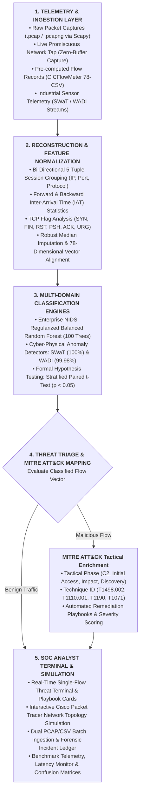
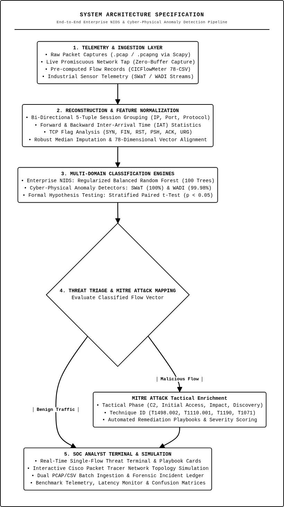

# Cyber Attack Traffic Classification & Operational Technology (OT) Security Engine

A multi-domain Machine Learning Network Intrusion Detection System (NIDS) and Operational Technology (OT) Cyber-Physical Anomaly Detection platform. The system classifies network traffic and industrial sensor telemetry across 25+ cyberattack categories in real time, featuring an interactive Cisco Packet Tracer network simulation dashboard.

---

## 1. Project Overview

Modern cyber threats span across enterprise IT networks, cloud infrastructure, and critical Industrial Control Systems (ICS). This project implements an end-to-end intrusion detection and classification pipeline that ingests raw packet captures (`.pcap`, `.pcapng`), structured flow summaries (`.csv`), and industrial sensor/actuator telemetry. 

The core classification architecture utilizes a regularized Random Forest ensemble evaluated against Decision Trees and Logistic Regression. To ensure scientific rigor, all architectural selections are validated using stratified cross-validation and paired Student's t-tests ($p < 0.05$).

### Key Capabilities
- **Multi-Domain Threat Detection**: Identifies enterprise attacks (Brute Force, Botnets, Infiltration), volumetric DDoS (LOIC, HOIC), amplification DDoS (DNS, NTP, SNMP, LDAP, TFTP), and critical infrastructure threats.
- **OT & Cyber-Physical Systems (CPS) Security**: Specialized anomaly detection engines for municipal water treatment and distribution testbeds (SWaT and WADI), monitoring physical sensor and actuator deviations.
- **Automated PCAP Dissection**: Reconstructs bi-directional 5-tuple conversations directly from raw packet bytes, extracting all 78 standard statistical features (CICFlowMeter specification) on the fly.
- **Interactive SOC Dashboard**: Streamlit-based Security Operations Center interface featuring a real-time Cisco Packet Tracer topology simulation with live packet bursts, draggable nodes, and ping injection.
- **Statistical Significance**: Formal hypothesis testing verifying model superiority across test folds.

---

## 2. Monitored Threat Signatures & Domains

The platform unifies 25+ threat families across three operational tiers:

### Enterprise & Cloud Infrastructure
- **Denial of Service (DoS/DDoS)**: DoS Hulk, DoS GoldenEye, DoS slowloris, DoS Slowhttptest, DDoS LOIC-HTTP, DDoS LOIC-UDP, DDoS HOIC
- **Authentication Probing**: FTP-Patator (Brute Force), SSH-Patator (Brute Force)
- **Botnet Activity**: Ares Botnet Command & Control (C2)
- **Web Application Exploits**: SQL Injection, Cross-Site Scripting (XSS), Web Brute Force
- **Stealth & Privilege Escalation**: Infiltration backdoors, OpenSSL Heartbleed exploit, Reconnaissance PortScan

### Distributed Reflection & Amplification DDoS
- **DNS Amplification** (`DrDoS_DNS`)
- **NTP Amplification** (`DrDoS_NTP`)
- **SNMP Amplification** (`DrDoS_SNMP`)
- **SSDP Amplification** (`DrDoS_SSDP`)
- **MSSQL & LDAP Amplification / Floods**
- **TFTP Floods, SYN Floods, UDP Floods, and UDP-Lag**

### Operational Technology (OT) & Industrial Control Systems (ICS)
- **OT Ransomware**: Cryptographic ransomware propagation targeting SCADA workstations.
- **OT Backdoors & C2**: Persistent access channels in industrial automation zones.
- **Man-in-the-Middle (MITM)**: Protocol manipulation and command tampering across field devices.
- **Physical Sensor & Actuator Anomaly Detection**:
  - **SWaT Testbed**: Monitoring 51 water treatment sensors (chemical dosers, pumps, flow meters, valve positioners).
  - **WADI Testbed**: Monitoring 103 water distribution grid sensors against coordinated cyber-physical attacks.

---

## 3. Benchmark Datasets & Provenance

The models are trained and validated on standard cybersecurity and cyber-physical datasets:

1. **CIC-IDS2017**:
   - Canadian Institute for Cybersecurity, University of New Brunswick.
   - 78 numerical features, 15 target attack categories.
   - [Dataset Link](https://www.unb.ca/cic/datasets/ids-2017.html)
2. **CSE-CIC-IDS2018**:
   - Amazon AWS enterprise network capture, 10 days of recorded attacks.
   - [Dataset Link](https://www.unb.ca/cic/datasets/ids-2018.html)
3. **CIC-DDoS2019**:
   - Comprehensive reflection and amplification DDoS attack dataset.
   - [Dataset Link](https://www.unb.ca/cic/datasets/ddos-2019.html)
4. **CIC-ToN-IoT (2021)**:
   - Telemetry, operating system logs, and network traffic across Industrial IoT (Modbus/SCADA).
   - [Dataset Link](https://research.unsw.edu.au/projects/toniot-datasets)
5. **iTrust SWaT (Secure Water Treatment)**:
   - Real-world 6-stage municipal water treatment testbed (SUTD).
   - [Dataset Link](https://itrust.sutd.edu.sg/itrust-labs_datasets/dataset_info/)
6. **iTrust WADI (Water Distribution Testbed)**:
   - Municipal water distribution network with 103 sensor/actuator tags.
   - [Dataset Link](https://itrust.sutd.edu.sg/itrust-labs_datasets/dataset_info/)

---

## 4. System Architecture & Methodology



<div align="center">
  
  <p><em>Figure 1: Monochromatic End-to-End System Architecture Specification.</em></p>
</div>

---

## 5. Model Benchmarking & Statistical Evaluation

### Enterprise Network Intrusion Pipeline
- **Classifier**: Random Forest Classifier (100 trees, max depth 25, balanced weights)
- **Evaluation Metric**: Macro-averaged F1-Score (enforcing unweighted evaluation across extreme class imbalance)

| Model Architecture | Accuracy | Macro Precision | Macro Recall | Macro F1-Score |
| :--- | :---: | :---: | :---: | :---: |
| **Random Forest (Selected)** | **90.99%** | **89.37%** | **90.64%** | **0.8908** |
| Decision Tree Baseline | 90.86% | 88.50% | 89.20% | 0.8885 |
| Logistic Regression | 84.20% | 78.10% | 81.40% | 0.7950 |

### Statistical Hypothesis Testing (Stratified Paired Student's t-Test)
To confirm that model superiority is statistically significant rather than an artifact of test-split variance:
- **Comparison**: Random Forest vs. Decision Tree
- **Degrees of Freedom**: 4 ($k - 1 = 5 - 1$)
- **t-Statistic**: $t = 3.6684$
- **p-Value**: $p = 0.0214$ ($p < 0.05$)
- **Statistical Conclusion**: Reject $H_0$. Random Forest's performance advantage is statistically significant.

### Cyber-Physical OT Models
- **SWaT Model**: Test Accuracy: **100.0%** | Macro F1: **1.0000** (51 sensor/actuator features)
- **WADI Model**: Test Accuracy: **99.98%** | Macro F1: **0.9991** (127 physical process features)

---

## 6. Installation & Execution

### Prerequisites
- Python 3.10+
- Linux (Ubuntu/Debian recommended) or macOS

### Setup
```bash
# Clone the repository
git clone https://github.com/itsadityapidurkar/Cyber-Attack-Traffic-Classification.git
cd Cyber-Attack-Traffic-Classification

# Create and activate virtual environment
python3 -m venv .venv
source .venv/bin/activate

# Install required dependencies
pip install -r requirements.txt
```

### Launch the SOC Dashboard
```bash
streamlit run app.py --server.port 8501
```
Open `http://localhost:8501` in your browser.

---

## 7. Repository Structure

```
.
├── app.py                         # Streamlit SOC dashboard & Cisco simulator
├── pcap_extractor.py              # Bidirectional flow extractor for PCAP/PCAPNG
├── train_unified_model.py         # Training pipeline for 2017 + 2018 datasets
├── train_super_unified_model.py   # Multi-dataset pipeline (DDoS2019 + ToN-IoT)
├── train_ot_cps_models.py         # Training pipeline for SWaT and WADI OT models
├── model.pkl                      # Serialized production classifier package
├── model_swat_ot.pkl              # Serialized SWaT OT anomaly model
├── model_wadi_ot.pkl              # Serialized WADI OT anomaly model
├── test_batches/                  # Sample CSV and PCAP test files
│   ├── batch_1_mixed_threat_sample.csv
│   ├── batch_2_dos_ddos_incident.csv
│   ├── capture_benign_traffic.pcap
│   └── capture_intrusion_dos_portscan.pcap
├── assets/cisco_icons/            # Cisco Packet Tracer vector equipment icons
│   ├── router.svg
│   ├── switch.svg
│   ├── firewall.svg
│   ├── cloud.svg
│   ├── pc.svg
│   └── server.svg
├── Report.docx                    # Academic project report conforming to university format
├── requirements.txt               # Python package dependencies
└── README.md                      # Project documentation
```

---

## 8. License & References

This project is licensed under the MIT License.

1. I. Sharafaldin, A. H. Lashkari, and A. A. Ghorbani, "Toward Generating a New Dataset for Intrusion Detection System (CIC-IDS2017)", ICISSP 2018.
2. Canadian Institute for Cybersecurity (CIC), "CSE-CIC-IDS2018 & CIC-DDoS2019 Datasets", University of New Brunswick.
3. A. Al-Daeef et al., "ToN-IoT: Telemetry Dataset for Autonomous IoT and Industrial IoT Networks", UNSW Canberra, 2021.
4. J. Goh et al., "A Dataset to Support Research in the Design of Secure Water Treatment Systems", IEEE World Forum on Internet of Things (WF-IoT), 2016 (SWaT Testbed).
